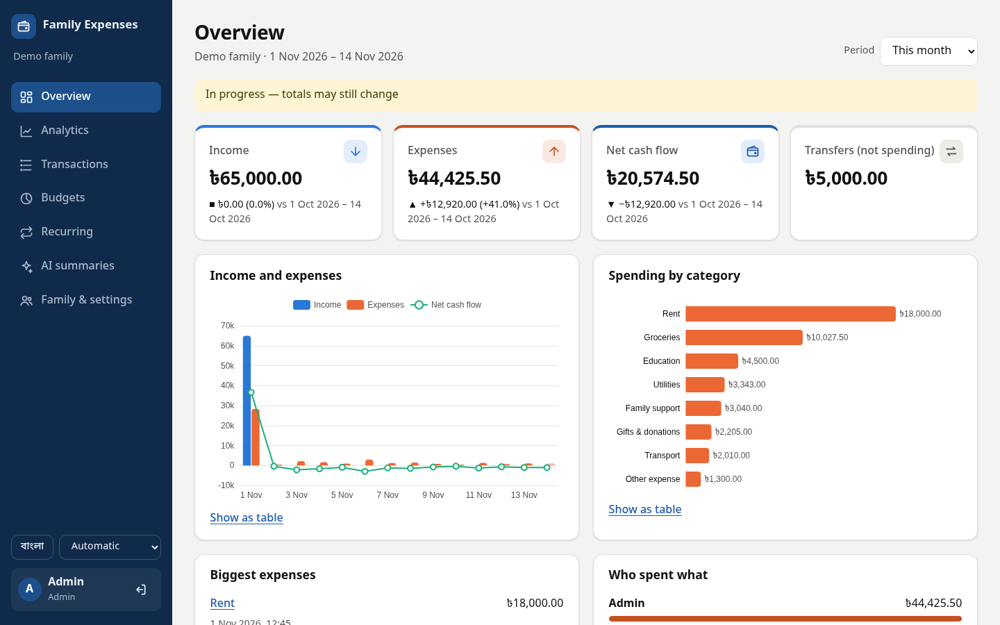
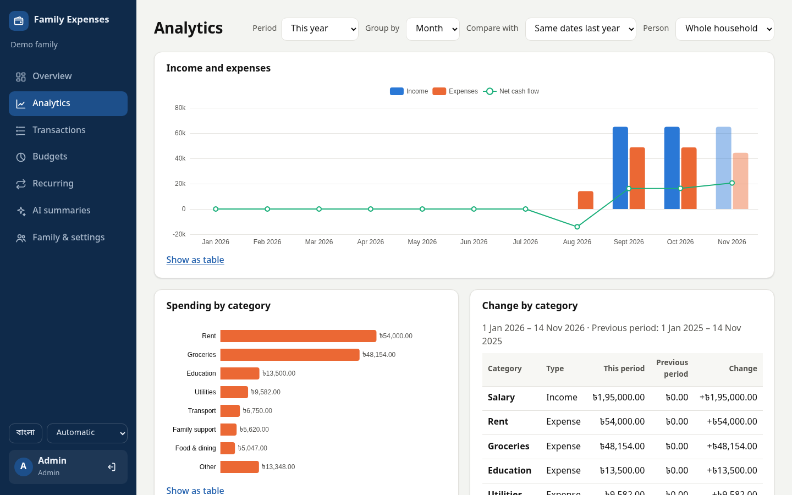
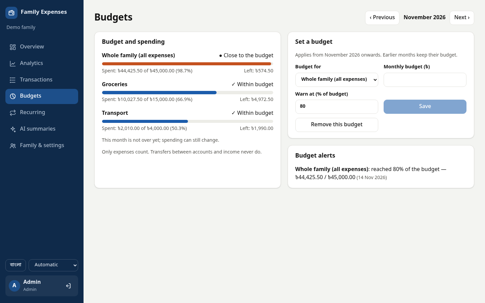
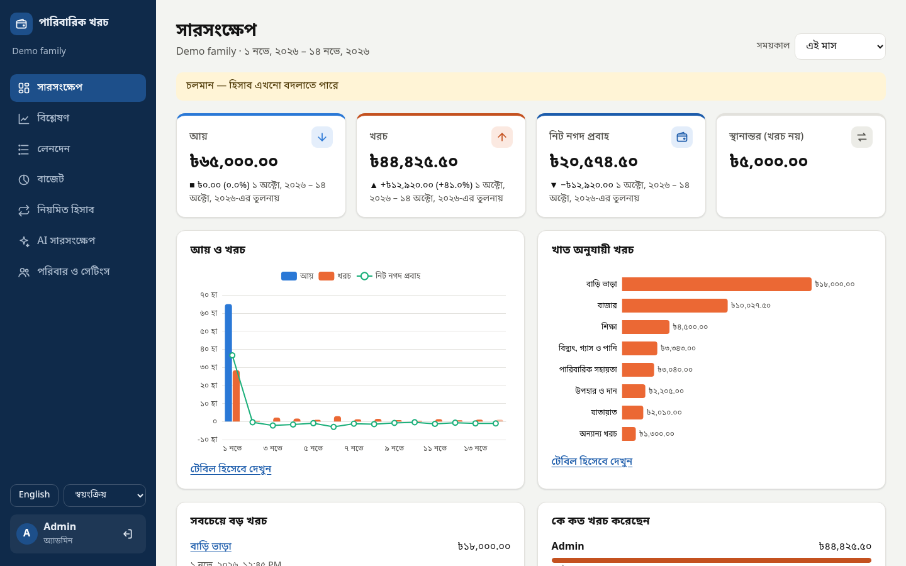
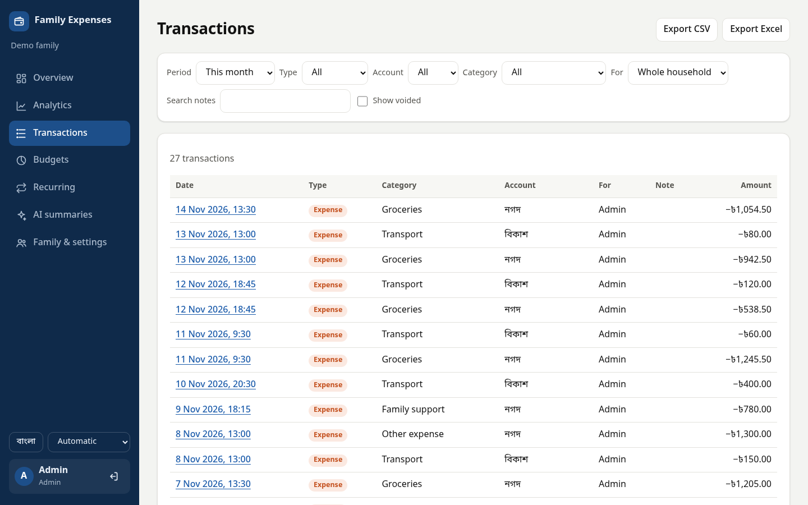

# Family Expense Tracker

A private, self-hosted expense tracker for one Bangladeshi household. An older
family member records spending on an Android phone in Bangla, even without a
connection; an administrator reviews it in a web dashboard on a PC. Amounts are
in BDT, dates follow Asia/Dhaka, and all data stays on the family's own server.

## What it does

- **Phone entry (Android, Bangla-first):** expenses, income and transfers
  between accounts, saved on the phone first and uploaded when the server is
  reachable. Large buttons; "Add expense" is always on the home screen.
- **Corrections:** edit or void an entry. Nothing is deleted; every change is
  kept in an audit log.
- **Accounts and balances:** cash, bank and mobile-money accounts with opening
  balances. Balances are computed from transactions, never stored. Accounts can
  be private to one family member.
- **Budgets and reminders:** monthly budgets per category with alerts, recurring
  entries (rent, bills) and due reminders on the phone.
- **Receipts:** attach a photo; the server reads the total and date with
  Tesseract OCR (Bangla and English) and suggests them.
- **Dashboard (PC):** totals, trends and category breakdowns with charts,
  a searchable transaction list, CSV and XLSX export, family members and
  invitations.
- **AI monthly summaries (optional):** a local llama.cpp model writes a short
  summary in Bangla or English. Every number in the text is checked against the
  real totals before it is shown, and transaction notes are never sent to the
  model.

## Screenshots

The dashboard with made-up demo data (three months of a sample household).

| Overview | Analytics |
|---|---|
|  |  |
| **Budgets** | **Overview in Bangla** |
|  |  |



## How it works

```
  Android phone                          PC browser
  Room database + upload queue           React dashboard (ECharts)
          │                                      │
          └────── HTTP, home Wi-Fi or VPN ──────┘
                           ▼
          web: Caddy (serves the dashboard, proxies /api)
                           ▼
          api: FastAPI   routes → services → models
                           │
                           ▼
          PostgreSQL ◀──── worker: receipt OCR, AI summaries ───▶ llama.cpp (optional)
              │
              ▼
          backup: nightly pg_dump + receipts (14 daily, 12 monthly)
```

- **One backend owns the rules.** The FastAPI app is the only component that
  talks to PostgreSQL. Routes stay thin; validation, permissions and the audit
  record live in `backend/app/services/`, and each write commits together with
  its audit event.
- **Money is exact.** Amounts are integer poisha (1 taka = 100 poisha) in the
  database, the API, the dashboard and the phone. No floating point anywhere.
- **Offline-first sync.** The phone writes each entry to its local Room database,
  then WorkManager uploads it. Every entry carries a client-generated ID, so a
  retried upload never creates a duplicate. Edits carry a `version` number; a
  stale edit is rejected instead of overwriting newer data.
- **Slow work runs in the background.** OCR and AI summaries are queued in the
  database and picked up by a separate worker process, so requests stay fast.
- **Households are isolated.** Every query is filtered by household, and another
  household's data answers `404`, as if it did not exist.

Details: [architecture](docs/architecture.md), [offline sync](docs/offline-sync.md),
[accounting rules](docs/accounting-rules.md).

## Prerequisites

**To run it (homelab):**

| Need | Version | Notes |
|------|---------|-------|
| Docker with the Compose plugin | recent | builds and runs the API, worker, dashboard and backups |
| PostgreSQL | 16 or newer (tested on 18) | can be an existing server; the stack does not include one |
| llama.cpp server | any | optional, only for AI summaries |
| Android phone | Android 8.0 (API 26) or newer | runs the debug build (see below) |

Tesseract OCR is installed inside the backend image; nothing else is needed on
the host.

**To develop it:**

| Need | Version | For |
|------|---------|-----|
| [`uv`](https://docs.astral.sh/uv/) | recent | backend; installs Python 3.12 itself |
| PostgreSQL role with `CREATEDB` | 16+ | backend tests create throwaway databases |
| Node.js and npm | 22 or newer | dashboard |
| JDK | 17 | Android app |
| Android SDK | platform 37 | Android app; an emulator for device tests |
| Tesseract with `ben` and `eng` data | any | optional; receipt OCR in development |
| A Chromium-based browser | any | optional; `scripts/e2e.sh` finds Chromium, Chrome, Brave or Edge on `PATH`, or set `E2E_BROWSER` |

## Run it on the homelab

The full steps, with the database setup and `pg_hba.conf` line, are in
[`docs/deployment.md`](docs/deployment.md). In short:

```bash
sudo -u postgres psql -v app_password="'<new strong password>'" -f deploy/setup-database.sql
cp deploy/.env.example deploy/.env && chmod 600 deploy/.env   # fill in the URLs, passwords, FET_JWT_SECRET, WEB_BIND, WEB_PORT
docker compose -f deploy/compose.yaml --env-file deploy/.env up -d --build
docker compose -f deploy/compose.yaml --env-file deploy/.env run --rm -it api \
  python -m app.cli bootstrap --username admin --display-name "Admin" --household "Our family"
sh deploy/verify.sh
```

The dashboard and the phone then use `http://<homelab-address>:<WEB_PORT>`. Other
family members join through invitations from the dashboard (Family & settings →
Members). The phone needs the **debug build**, because release builds accept
only HTTPS servers.

## Local development

### Backend

Run in `backend/`.

1. **Database.** On the PostgreSQL server, as a superuser (choose your own
   password):

   ```sql
   CREATE ROLE fet_app LOGIN PASSWORD '<app password>';
   CREATE DATABASE fet_dev OWNER fet_app;
   ```

2. **Install and migrate:**

   ```bash
   uv sync                          # creates .venv from uv.lock
   cp .env.example .env             # gitignored; set FET_DATABASE_URL
   # percent-encode special characters in the password: @ → %40, : → %3A, / → %2F
   uv run alembic upgrade head
   ```

3. **First admin** (asks for the password; refuses if any user exists):

   ```bash
   uv run python -m app.cli bootstrap --username admin --display-name "Admin" --household "Our family"
   ```

4. **Run the API and the worker** (two terminals):

   ```bash
   uv run uvicorn app.main:create_app --factory --reload --host 127.0.0.1 --port 8000
   uv run python -m app.worker      # receipt OCR and AI summaries
   ```

   Health check: http://127.0.0.1:8000/api/v1/health. Interactive API docs
   (development only): http://127.0.0.1:8000/docs.

5. **Tests and checks:**

   ```bash
   cp .env.test.example .env.test   # a role with CREATEDB; see docs/testing.md
   uv run pytest
   uv run ruff check app tests alembic && uv run ruff format --check app tests alembic
   uv run mypy app
   ```

   Tests create and drop their own `fet_test_<random>` database and never touch
   any other database.

### Dashboard

Run in `dashboard/`, with the backend running on `127.0.0.1:8000`.

```bash
npm install
npm run dev                        # http://127.0.0.1:5173, proxies /api to the backend
npm test && npm run typecheck && npm run lint && npm run build
```

Sign in with the admin created by `bootstrap`. Details:
[`docs/dashboard.md`](docs/dashboard.md).

### Android app

Run in `android/`, with `ANDROID_HOME` pointing at the Android SDK.

```bash
./gradlew assembleDebug testDebugUnitTest
ANDROID_SERIAL=emulator-5554 ./gradlew connectedDebugAndroidTest
```

**Always set `ANDROID_SERIAL` for device tests.** Without it, Gradle runs them on
every connected device and uninstalls the app afterwards, which deletes entries
on a real phone that have not been uploaded yet.

From the emulator, the development backend is at `http://10.0.2.2:8000`.
Details: [`docs/android.md`](docs/android.md).

### End-to-end check

```bash
scripts/e2e.sh                     # backend + dashboard in a headless browser (+ phone if the emulator runs)
scripts/e2e.sh --require-phone     # fail when no emulator is running
```

It uses a throwaway database and removes everything it created, also on failure.

## Status

Milestones 1–5 are complete and tested. Milestone 6 (production hardening) is in
progress: the Docker Compose stack, daily backups, XLSX export, the
end-to-end check and a security review with its fixes
([`docs/security.md`](docs/security.md)) are done; APK signing and an
accessibility review remain. See [`TASKS.md`](TASKS.md) and
[`CHANGELOG.md`](CHANGELOG.md).

## Documentation

[Requirements](docs/requirements.md) · [Architecture](docs/architecture.md) ·
[Data model](docs/data-model.md) · [Accounting rules](docs/accounting-rules.md) ·
[API](docs/api.md) · [Security](docs/security.md) ·
[Offline sync](docs/offline-sync.md) · [AI integration](docs/ai-integration.md) ·
[Voice entry evaluation](docs/voice-evaluation.md) · [Dashboard](docs/dashboard.md) ·
[Android](docs/android.md) · [Deployment](docs/deployment.md) ·
[Testing](docs/testing.md) · [Decisions](docs/decisions/)

## Licence

MIT. See [`LICENSE`](LICENSE).
